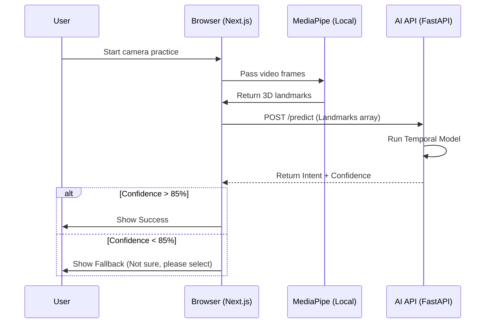

# SIGNBRIDGE INDIA - Technical Architecture

This document defines the complete technical architecture for the SIGNBRIDGE INDIA MVP. It strictly adheres to the PRD constraints: maintaining simplicity, avoiding unnecessary microservices, prioritizing mobile-first PWA delivery, and ensuring data privacy (no raw camera frame storage).

## 1. System Architecture

The MVP utilizes a pragmatic, hackathon-optimized 3-tier architecture:
1. **Client Tier**: Next.js Progressive Web App (PWA) handling all user interfaces, local camera access, and offline capabilities.
2. **AI API Tier**: A lightweight Python FastAPI service dedicated exclusively to ML inference.
3. **Data/BaaS Tier**: Supabase providing managed PostgreSQL, Authentication, Object Storage, and Realtime WebSockets.

**Why this approach?**
By using Supabase for standard CRUD and Auth directly from the Next.js frontend, we eliminate the need to write boilerplate API routes. The Python API is reserved solely for AI/ML tasks that require PyTorch/ONNX, keeping the architecture incredibly simple and fast to build.

## 2. Frontend Architecture

- **Framework**: Next.js 14+ (App Router) with TypeScript.
- **Styling**: Tailwind CSS + shadcn/ui (Accessible, fast, clean components).
- **State Management**: React Context for global state (Auth, Service context), and local component state.
- **Client-Side AI Preprocessing**: MediaPipe JS running in the browser to extract hand/pose landmarks locally.
- **PWA**: `next-pwa` (or standard Service Worker setup) to manage offline capabilities and caching.

## 3. Backend Architecture

- **Framework**: FastAPI (Python).
- **Responsibility**: Exposing the `/ai/predict` endpoint.
- **Dependencies**: PyTorch / ONNX Runtime, NumPy.
- **Pattern**: Stateless REST API. Receives a sequence of normalized landmarks, runs the temporal model, and returns intent predictions with confidence scores.

## 4. Database Architecture

- **Provider**: Supabase Managed PostgreSQL.
- **Access Control**: Strict Row Level Security (RLS) policies.
- **Schema Mapping**:
  - `users` (Managed by Supabase Auth, extended in public schema)
  - `institutions`, `access_points`, `staff_profiles` (Core institutional data)
  - `courses`, `lessons`, `service_packs`, `phrases` (Read-heavy content data)
  - `practice_sessions`, `ai_predictions`, `feedback`, `assistance_requests` (Write-heavy transactional data)

## 5. Authentication Architecture

- **Provider**: Supabase Auth.
- **Citizen Access**: Anonymous/Guest access is **enabled by default**. Basic Access Point functionality works without an account.
- **Staff/Admin Access**: Email/OTP or Magic Links for institutional staff to access training and dashboards.
- **Authorization**: Roles (citizen, staff, admin, interpreter) enforced via RLS in the database.

## 6. AI/ML Architecture

- **Capture**: User browser `getUserMedia` captures video.
- **Extraction (Client-side)**: MediaPipe extracts 3D landmarks (x, y, z) for hands and upper body.
- **Transmission**: Only normalized landmark coordinates (not images) are sent to the AI API.
- **Model**: A small Temporal Convolutional Network (TCN) or GRU trained on 30-50 high-value intents.
- **Safety Gate**: The FastAPI endpoint returns `intent` and `confidence`. The frontend enforces a strict threshold (e.g., >85%). If confidence is low, the UI triggers the safe fallback (manual phrase selection).

## 7. PWA & Offline Architecture

- **Service Worker**: Intercepts network requests and serves cached static assets (HTML/CSS/JS).
- **IndexedDB**: Stores downloaded "Service Packs" (JSON metadata + small compressed video assets/images) for offline district access.
- **Offline Flow**:
  - If offline, the QR scan loads the cached Service Pack from IndexedDB.
  - The static phrase board functions 100% locally.
  - AI prediction is disabled unless an in-browser ONNX model is loaded.
  - Feedback/ratings are queued in IndexedDB and flushed to Supabase when the connection is restored via the Background Sync API.

## 8. API Architecture

- **Frontend -> Supabase**: Direct database access via `@supabase/supabase-js` using RLS for CRUD operations (Institutions, Packs, Feedback).
- **Frontend -> AI API**: POST `/api/v1/predict` with JSON payload of landmark arrays.
- **AI API -> Supabase**: Logs telemetry (anonymized predictions and model metrics) using a service-role key.

## 9. Storage Architecture

- **Provider**: Supabase Storage.
- **Buckets**:
  - `learning-assets`: Public bucket containing micro-course videos (with captions).
  - `service-pack-assets`: Public bucket containing ISL phrase videos/animations.
  - `institution-assets`: Public bucket for logos/QR codes.
- **Privacy Rule**: Raw camera frames are NEVER stored anywhere.

## 10. Realtime Architecture

- **Provider**: Supabase Realtime (WebSockets over PostgreSQL).
- **Use Case**: Human Escalation.
  - When a user taps "Need human assistance", an insert occurs in `assistance_requests`.
  - The Operator/Interpreter Dashboard subscribes to inserts on this table and updates instantly without polling.

## 11. Security Architecture

- **Data Privacy**: No video uploads. Landmarks only.
- **Authentication**: JWT tokens managed by Supabase.
- **Database**: RLS prevents users from reading/writing data they don't own (except public content).
- **Secrets**: Environment variables strictly segregated (`NEXT_PUBLIC_` for safe client keys, private for server keys). Service-role keys are never exposed to the frontend.

## 12. Deployment Architecture

- **Frontend (Next.js)**: Vercel (Auto-scaling, edge caching, built-in CI/CD).
- **Backend (FastAPI)**: Render or Railway (Simple Docker container deployment for Python).
- **Database/BaaS**: Supabase Cloud.
- **Continuous Integration**: GitHub Actions for running linting and tests before merge.

## 13. Folder Structure (Monorepo)

```text
/
├── apps/
│   ├── web/                  # Next.js Frontend
│   │   ├── app/              # App Router (pages)
│   │   ├── components/       # UI Components (shadcn, etc.)
│   │   ├── lib/              # Utils, Supabase client
│   │   ├── public/           # Static assets, PWA manifest
│   │   └── types/            # TypeScript interfaces
│   └── api/                  # Python FastAPI Backend
│       ├── main.py           # API entrypoint
│       ├── model/            # PyTorch/ONNX model files
│       ├── routers/          # API endpoints
│       └── requirements.txt  # Python deps
├── packages/                 # Shared configs (if needed)
├── .agents/                  # Workspace rules
├── README.md
└── architecture.md
```

## 14. Data Flow Diagrams

### AI Practice Flow



## 15. Request/Response Flow for Major Features

### Feature: Access Point QR Scan (Offline-capable)
1. **Request**: User scans QR (`/access?id=hosp_123`)
2. **Check**: Service Worker checks if `service_pack_hosp_123` exists in local IndexedDB.
3. **Response (Online)**: Frontend fetches institution and service pack from Supabase. Caches it in IndexedDB. Renders UI.
4. **Response (Offline)**: Frontend reads directly from IndexedDB. Renders UI.

### Feature: Request Human Escalation
1. **Request**: Frontend inserts into Supabase `assistance_requests` with `access_point_id` and `urgency`.
2. **Database**: Row is inserted. Supabase Realtime triggers a broadcast.
3. **Response**: Client receives the request ID plus a private tracking token and shows the four-stage progress tracker.
4. **Operator Flow**: Operator dashboard receives Realtime changes and moves the request forward only: `pending` → `accepted` → `in_progress` → `resolved`.
5. **Client Flow**: Signed-in users receive authorized Realtime changes; anonymous users poll the token-protected, status-only RPC. Operator identity is not exposed.
