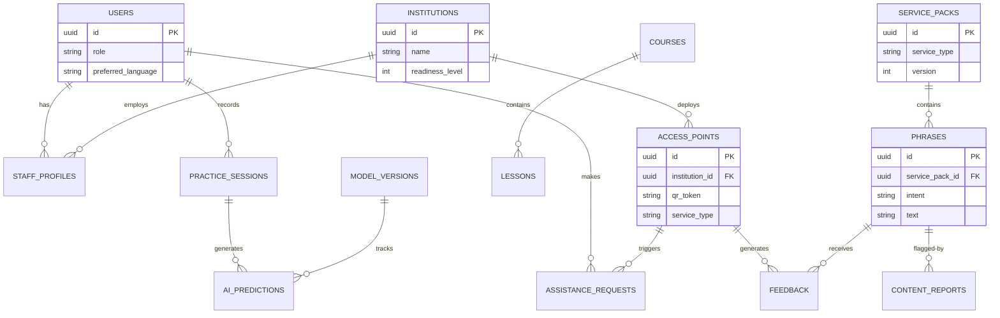

# SIGNBRIDGE INDIA - Database Architecture

This document defines the complete PostgreSQL/Supabase database design for SIGNBRIDGE INDIA, adhering to the requirements outlined in the PRD and Architecture documents.

## 1. Entity-Relationship Diagram

---

## 2. Tables, Columns, Data Types, Keys & Constraints

### 2.1 Core Identity & Access
**`public.users`** (Extends `auth.users`)
- `id` (UUID, PK) - Maps to `auth.users.id`
- `role` (TEXT) - e.g., 'citizen', 'staff', 'admin', 'interpreter' (Default: 'citizen')
- `preferred_language` (TEXT) - e.g., 'en', 'hi', 'te' (Default: 'en')
- `accessibility_preferences` (JSONB) - UI overrides
- `created_at` (TIMESTAMPTZ, Default: NOW())

### 2.2 Institutional Data
**`public.institutions`**
- `id` (UUID, PK, Default: uuid_generate_v4())
- `name` (TEXT, Not Null)
- `type` (TEXT, Not Null) - e.g., 'hospital', 'college', 'bank'
- `district` (TEXT, Not Null)
- `state` (TEXT, Not Null)
- `address` (TEXT)
- `readiness_level` (INTEGER, Default: 0) - Calculated score

**`public.access_points`**
- `id` (UUID, PK, Default: uuid_generate_v4())
- `institution_id` (UUID, FK -> `institutions.id`, Not Null)
- `service_type` (TEXT, Not Null) - e.g., 'registration', 'pharmacy'
- `qr_token` (TEXT, Unique, Not Null) - URL safe token for QR code
- `nfc_id` (TEXT, Unique, Nullable)
- `active` (BOOLEAN, Default: true)

**`public.staff_profiles`**
- `id` (UUID, PK, Default: uuid_generate_v4())
- `user_id` (UUID, FK -> `users.id`, Not Null)
- `institution_id` (UUID, FK -> `institutions.id`, Not Null)
- `role` (TEXT, Not Null) - e.g., 'receptionist', 'nurse'
- `training_level` (INTEGER, Default: 0)
- `badge` (TEXT, Nullable)
- *Constraint: Unique (`user_id`, `institution_id`)*

### 2.3 Learning Ecosystem
**`public.courses`**
- `id` (UUID, PK, Default: uuid_generate_v4())
- `category` (TEXT, Not Null)
- `language` (TEXT, Not Null)
- `level` (TEXT, Not Null) - e.g., 'beginner', 'intermediate'
- `title` (TEXT, Not Null)

**`public.lessons`**
- `id` (UUID, PK, Default: uuid_generate_v4())
- `course_id` (UUID, FK -> `courses.id`, Not Null)
- `title` (TEXT, Not Null)
- `video_url` (TEXT, Not Null)
- `duration` (INTEGER, Not Null) - In seconds
- `version` (INTEGER, Default: 1)

### 2.4 Service & Phrase Dictionary
**`public.service_packs`**
- `id` (UUID, PK, Default: uuid_generate_v4())
- `service_type` (TEXT, Not Null) - Matches `access_points.service_type`
- `locale` (TEXT, Not Null)
- `version` (INTEGER, Default: 1)
- `content_hash` (TEXT, Not Null)
- *Constraint: Unique (`service_type`, `locale`, `version`)*

**`public.phrases`**
- `id` (UUID, PK, Default: uuid_generate_v4())
- `service_pack_id` (UUID, FK -> `service_packs.id`, Not Null)
- `intent` (TEXT, Not Null) - Abstract action (e.g., 'need_appointment')
- `text` (TEXT, Not Null) - Display text
- `isl_asset` (TEXT, Not Null) - Path to video/animation
- `source` (TEXT, Default: 'official') - e.g., 'ISLRTC', 'community'
- `reviewed_by` (UUID, FK -> `users.id`, Nullable)

### 2.5 Telemetry & Practice
**`public.practice_sessions`**
- `id` (UUID, PK, Default: uuid_generate_v4())
- `user_id` (UUID, FK -> `users.id`, Not Null)
- `phrase_id` (UUID, FK -> `phrases.id`, Not Null)
- `score` (INTEGER, Nullable)
- `confidence` (NUMERIC(5,2), Nullable)
- `created_at` (TIMESTAMPTZ, Default: NOW())

**`public.ai_predictions`**
- `id` (UUID, PK, Default: uuid_generate_v4())
- `session_id` (UUID, FK -> `practice_sessions.id`, Nullable)
- `predicted_intent` (TEXT, Not Null)
- `confidence` (NUMERIC(5,2), Not Null)
- `accepted` (BOOLEAN, Not Null)
- `model_version` (TEXT, Not Null)

### 2.6 Realtime & Escalation
**`public.assistance_requests`**
- `id` (UUID, PK, Default: uuid_generate_v4())
- `access_point_id` (UUID, FK -> `access_points.id`, Not Null)
- `user_id` (UUID, FK -> `users.id`, Nullable) - Nullable for anonymous access
- `urgency` (TEXT, Default: 'normal') - 'normal', 'high', 'emergency'
- `status` (TEXT, Default: 'pending') - 'pending', 'accepted', 'in_progress', 'resolved'
- `operator_id` (UUID, Nullable) - Assigned interpreter/operator after acceptance
- `tracking_token` (UUID, private) - Unguessable token for anonymous status-only lookup
- `accepted_at`, `started_at`, `resolved_at` (TIMESTAMPTZ, Nullable) - Lifecycle timestamps
- `updated_at` (TIMESTAMPTZ) - Last status update
- `created_at` (TIMESTAMPTZ, Default: NOW())

### 2.7 Feedback & Community
**`public.feedback`**
- `id` (UUID, PK, Default: uuid_generate_v4())
- `access_point_id` (UUID, FK -> `access_points.id`, Nullable)
- `phrase_id` (UUID, FK -> `phrases.id`, Nullable)
- `outcome` (TEXT, Not Null) - 'success', 'failure'
- `rating` (INTEGER, Nullable) - 1 to 5
- `comment` (TEXT, Nullable)

**`public.content_reports`**
- `id` (UUID, PK, Default: uuid_generate_v4())
- `phrase_id` (UUID, FK -> `phrases.id`, Not Null)
- `reporter_type` (TEXT, Not Null) - 'citizen', 'staff'
- `reason` (TEXT, Not Null)
- `status` (TEXT, Default: 'open') - 'open', 'reviewed', 'resolved'

### 2.8 AI Model Governance
**`public.model_versions`**
- `id` (UUID, PK, Default: uuid_generate_v4())
- `version` (TEXT, Unique, Not Null)
- `dataset_version` (TEXT, Not Null)
- `metrics` (JSONB, Not Null) - e.g., {"f1_score": 0.85, "rejected": 0.05}
- `deployed_at` (TIMESTAMPTZ, Default: NOW())

---

## 3. Database Indexes

To ensure fast read queries, specifically for location-based and offline PWA context lookups:
- `idx_access_points_qr` ON `access_points(qr_token)`
- `idx_service_packs_lookup` ON `service_packs(service_type, locale, version)`
- `idx_phrases_spack` ON `phrases(service_pack_id)`
- `idx_assistance_status` ON `assistance_requests(status)` (Used heavily by Realtime subscriptions)
- `idx_feedback_ap` ON `feedback(access_point_id)`

---

## 4. User Roles and Permissions

Roles are assigned within the `public.users.role` column and utilized in Row Level Security (RLS).
1. **Citizen (Default)**: Read-only access to packs/courses. Insert-only access to feedback and requests.
2. **Staff**: Can update `staff_profiles` for themselves, read institutional metrics they belong to.
3. **Interpreter**: Can read and update `assistance_requests` globally.
4. **Admin**: Full CRUD over all tables. Can validate `phrases`.

---

## 5. Row Level Security (RLS) Policies

Supabase operates entirely via RLS for client-side API requests.

- **Public Data (`institutions`, `access_points`, `courses`, `lessons`, `service_packs`, `phrases`)**
  - Read: `auth.uid() IS NOT NULL OR auth.uid() IS NULL` (Anyone can read, allowing anonymous offline caching).
  - Write: Restricted to `role = 'admin'`.

- **Personal Data (`users`, `practice_sessions`, `staff_profiles`)**
  - Read/Write: `auth.uid() = user_id` (Users only see/edit their own data).

- **Realtime / Escalation (`assistance_requests`)**
  - Insert: Anyone (including anonymous) can insert.
  - Read/Update: Staff at the related institution, Interpreters, and Admins.

- **Analytics (`feedback`, `ai_predictions`)**
  - Insert: Anyone can insert.
  - Read: Admins and associated Institution Staff.

---

## 6. Audit Logging Strategy

- Since the MVP requires simplicity, we avoid complex trigger-based historical shadow tables.
- **Data Provenance**: Content tables (`phrases`) contain a `reviewed_by` UUID.
- **Escalation Tracing**: `assistance_requests` acts as an append-only state log until `resolved`.
- **Infrastructure Auditing**: Supabase provides built-in API request logging via pgAudit and Log Explorer for all backend administrative actions.

---

## 7. Model Versioning Strategy

- The `model_versions` table explicitly stores the lineage of the deployed AI model.
- Every prediction inserted into `ai_predictions` must reference the active `model_version`.
- This ensures that if Model v1.2 starts rejecting too many signs, we can query `ai_predictions` where `model_version = 'v1.2'` to isolate the regression and avoid fabricating accuracy metrics.

---

## 8. Service-Pack Versioning Strategy

- **Immutability for Offline**: Service packs are cached via IndexedDB. If an existing pack changes, the PWA needs to know to redownload it.
- **Implementation**: 
  - `service_packs` uses an explicit `version` integer and a `content_hash`.
  - When the frontend loads the QR `access_point`, it queries `/service-packs/{id}`. If the latest `version` from the DB is higher than the cached PWA version, the frontend downloads the new JSON manifest and syncs the associated `phrases`.
  - Never mutate existing phrases inline if the meaning changes drastically; instead, bump the service pack version or insert a new phrase row to preserve historical `practice_sessions` references.
